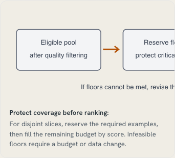
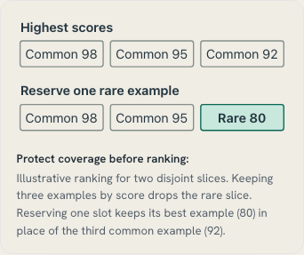

# Learning library and Chapter 9

Two independent reviewers examined the existing static site at 390 × 844 and 1440 × 900. One evaluated the reading experience and compared Chapter 8. The other inspected the rendered controls and ran Impeccable’s detector. The score below describes the opening assessment.

## What teaches well

The library cover makes the book easy to recognise. The chapter feels like technical reading material, with a quiet serif hierarchy, source attribution and room for equations. Chapter 9’s strongest example compares three complete runs at the same quality. The 7-, 10- and 11-hour totals let the reader decide when the selection pass earns back its cost. The first self-test explains why a plausible storage-bandwidth answer misses the actual data constraint.

## Findings in reading order

| Priority | Observed behaviour | Refinement |
|---|---|---|
| P2 | The cover, status and type columns left the phone book description about 176 px of the 342 px reading width. The research row reserved space for an absent image. | Give descriptions a full row on phones and let entries without artwork use both columns. |
| P2 | Four statistics and a link to an unavailable packet preceded the chapter list. The Chapter 9 row began around y=1492 on a phone. | Bring an available packet into the overview and express availability in a sentence. |
| P2 | At phone width the Chapter 9 thesis began around y=785, after the player and contents. Chapter 8’s began around y=897. | Put Chapter 9’s timing question immediately below its title. Keep the full thesis and audio player available to readers who want the argument or the narration. |
| P1 | A tap on the first gloss put its right edge at x=460 on a 390 px screen. | Clamp the open explanation from its natural position on each pointer or focus event. Test by actually tapping the mark. |
| P1 | All five drawings needed horizontal scrolling at 390 px. Two reused an SVG title ID, giving the data-path illustration the coverage figure’s accessible name. | Draw compact comparisons with scoped styles and identifiers. Show the rare example that replaces a common one under a fixed budget. |
| P2 | Six chart labels were truncated. Two access strategies needed about 105 px in a 70 px label column. | Give the category labels enough space and test the rendered text bounds after chart hydration. |

Chapter 8’s memory walkthrough gives readers a quantity to track. The equivalent thread for Chapter 9 is the fixed budget or evaluation target. The new coverage example uses three slots in both rows, so the reader can point to the exact trade. A shared support-ticket example does the same for two sources of supervision.

## The same figure on a 390 px phone

| Before | After |
|---|---|
|  |  |

The chapter originally had five sketches, three charts and seventeen glosses. Chapter 8 had three sketches, three charts and twenty glosses. Those totals pointed away from a quota. The section-by-section pass exposed where a new example, a shorter figure or a prose table would explain a decision more clearly.

## Assessment evidence

The qualitative assessment scored 27/40. The scores in Nielsen order were 3, 3, 3, 3, 3, 2, 2, 3, 3 and 2. First-time readers spent the most effort finding a readable chapter. Phone readers had the greatest trouble keeping the evidence and explanation visible together.

The deterministic source scan reported zero findings across six markup files. The in-browser scan flagged 2 elements in the library, 2 in the book overview and 104 on the hydrated chapter. Of the chapter findings, 71 concerned line length, 17 shared a single popover shadow treatment and 6 were chart-label overflows. The browser counts are signals to inspect. The initial learning and interaction findings above include only behaviours reproduced on the page. The overlay ran in the reviewers’ isolated tabs and those tabs were closed afterward.

## Recheck

The revised opening question begins 252 px from the top of a 390 × 844 viewport. The coverage figure shows both allocations at once. A learner can now follow the example from the three-slot budget to the displaced score and read the complete gloss after tapping. Keyboard and touch browser tests followed the book link from the library, opened the chapter, checked the figures, submitted a plausible wrong answer and verified the exported Markdown.

The main remaining typography issue is the desktop reading measure. The original thesis and guided bullets occupied roughly 100 characters per line. A comparison of narrower prose alongside full-width figures would be a useful next design review.
