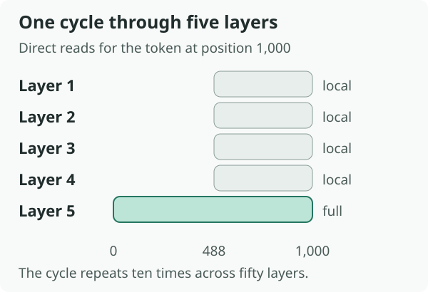
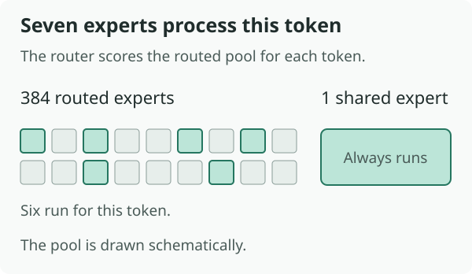
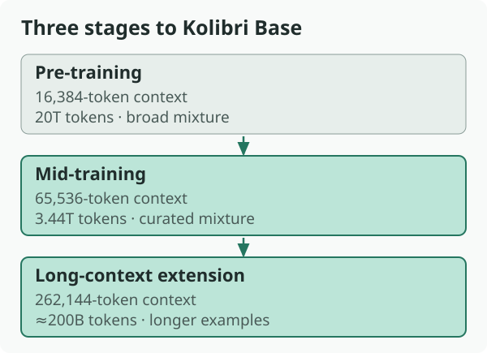
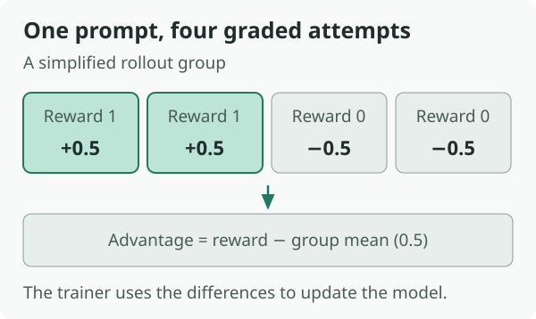
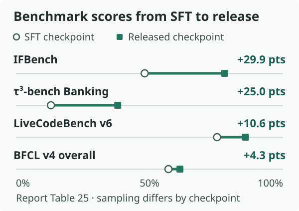
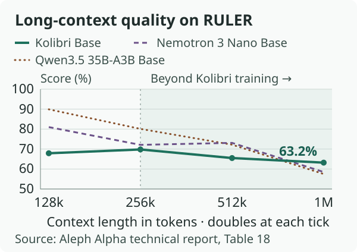
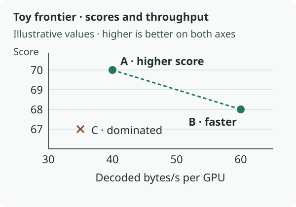
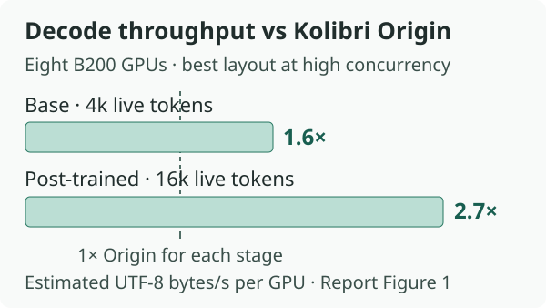

Take a token halfway through a long German document. Kolibri has two decisions to make about it in each layer. Which earlier tokens should it read? Which of its feed-forward networks should it run? The first decision controls how information moves between positions. The second controls how much of the model's stored capacity does work for this token.

Aleph Alpha's report lets us put numbers on both decisions. Kolibri has **78.1 billion parameters**, but uses about **3.46 billion** per token. It trains at up to **262,144 tokens**, and the authors evaluate it beyond that. Those figures describe different parts of the serving budget. [Technical report and Figure 4](https://aleph-alpha.com/downloads/tech-report.pdf#page=7)

<StatGroup>
  <Stat label="Total parameters" value="78.1B" context="Weights the model can use" />
  <Stat label="Active per token" value="3.46B" context="One token’s forward path" />
  <Stat label="Training context" value="256k" context="Final long-context stage" />
</StatGroup>

<KolibriExplorers />

## First, let the token read

A token starts as a vector of 2,560 numbers. Each of the 50 transformer layers updates that vector twice. Attention gathers information from earlier positions. A feed-forward branch then transforms the result at the current position. Both branches add their updates back to the same running vector, called the residual stream.

In every group of five layers, the first four look back at most 512 positions plus the current token. The fifth can read the whole prefix. At position 1,000, a local query can directly read positions 488 through 1,000. A full-attention query can read from position zero. Local layers use rotary position encoding, or RoPE. Full layers add no RoPE of their own and receive vectors that have already passed through the local layers. [Report §2.1.3](https://aleph-alpha.com/downloads/tech-report.pdf#page=12)

Each layer makes 48 queries in parallel, but stores only four sets of past keys and values. Each group of 12 query heads shares one key/value head. Grouped-query attention gives the model this sharing pattern. The queries can still learn different patterns while reusing the same stored representations. Combine head sharing with the local windows and you can estimate what the cache will cost.

At 262,144 tokens, a request needs about **2.52 GiB** of idealised FP8 key/value storage. Each cached position costs 1,024 bytes per layer. Ten full layers keep the entire prefix, and 40 local layers keep up to 513 entries each. With all 50 layers keeping the whole prefix, the same head configuration comes to **12.50 GiB**.

The estimate assumes local eviction and excludes allocator overhead and other buffers. The ten full layers keep accumulating entries. At one million tokens, the hybrid cache reaches about **10 GiB**. [Checkpoint configuration](https://huggingface.co/Aleph-Alpha/Kolibri-1/blob/main/config.json)

## Then send it through seven experts

Each layer has 384 routed experts and one shared expert. The router picks six for this token, and the shared expert runs as well.

An expert is a small feed-forward network with three main weight matrices. At Kolibri's dimensions, that comes to roughly 3.93 million weights per expert. Store 385 experts in each of 50 layers and you have 75.69 billion expert weights. Run seven in each layer and you use about 1.38 billion. Attention projections, router weights and the vocabulary projection bring the forward path to about 3.46 billion.

The router uses two scores for different jobs. Suppose three raw logits are 2, 1 and 0, and the router has room for two experts. Add a selection bias of 3 to the last expert and the router picks the first and last. Their mixture weights are still the sigmoids of the raw scores, about 0.88 and 0.50.

The bias determines who gets a slot. The raw score still sets the contribution. The model adds the shared expert separately. [Report §2.1.5](https://aleph-alpha.com/downloads/tech-report.pdf#page=16)

This creates a scheduling problem. A batch of 1,024 tokens makes 6,144 routed assignments. Perfect balance across 384 experts gives 16 assignments apiece. A device handling a popular expert can slow down a step even if the global average looks healthy.

Aleph Alpha uses Exact Quantile Balancing to update selection biases across the optimiser batch. Load-Error Injection gives the router a correction within each microbatch. The released FP8 model still has about 78 GB of weights. A batch can visit many experts. The runtime needs enough memory and bandwidth to reach their weights. [Model card](https://huggingface.co/Aleph-Alpha/Kolibri-1)

## Teach the base model, then teach the assistant

The first three stages use next-token prediction. Aleph Alpha pre-trains on about 20 trillion tokens at 16k context, shifts toward curated data for 3.44 trillion tokens at 64k, then uses roughly 200 billion tokens to train at 256k. Packing short independent documents into a long tensor gives the model few chances to connect questions with distant evidence. Longer examples give it that practice. The authors also find that favouring longer documents changes the mix of subjects. [Report §2.3](https://aleph-alpha.com/downloads/tech-report.pdf#page=24)

The bilingual design starts with the tokeniser. UniBPE builds a vocabulary by merging pairs, but chooses merges based on how they change unigram likelihood. On the authors' German web sample, Kolibri uses 11.2% fewer tokens than the GPT-5 tokeniser they compare against. On a separate German morphology test, 65.2% of its predicted boundaries align with a labelled morpheme boundary, compared with 47.3% for that tokeniser. A denser representation lets a fixed token budget hold more text in that sample. Answer quality also depends on which German material the model saw and how it learned to respond. [Report §2.1.2 and Appendix B.1](https://aleph-alpha.com/downloads/tech-report.pdf#page=9)

Supervised fine-tuning teaches formats and behaviours such as tool calls, grounded answers and optional reasoning. The serving template expresses effort as a sentence in the system prompt. During training, the team assigns effort labels by comparing traces from the same dataset and difficulty. This gives one checkpoint a direct-answer mode and three reasoning settings. Higher effort tends to generate more reasoning tokens, and the length also depends on the prompt. [Report Figure 26](https://aleph-alpha.com/downloads/tech-report.pdf#page=61)

Reinforcement learning then samples several attempts at a task and scores their outcomes. If four attempts score 1, 1, 0 and 0, subtracting the group mean of 0.5 gives two positive and two negative advantages. Those relative scores tell the trainer which attempts to reinforce. [Report §3.2](https://aleph-alpha.com/downloads/tech-report.pdf#page=71)

## Where the released model performs well

<StatGroup>
  <Stat label="English overall" value="75.5%" context="54.1% for Kolibri Origin" />
  <Stat label="German overall" value="70.8%" context="46.4% for Kolibri Origin" />
  <Stat label="IFBench" value="+29.9 pp" context="48.2% at SFT to 78.1% at release" />
</StatGroup>

Aleph Alpha evaluates the released model at high reasoning effort. The English and German aggregates use different sets of tasks, and both exclude the long-context benchmarks. Compare each language with its own baseline. [Report §3.3](https://arxiv.org/html/2610.31945v1#Pt3.S3)

Benchmark names link to the original projects. Bars show the reported score on a 0–100% scale. Bold marks the highest score among the entries shown in each row.

| Benchmark score (%) | SFT | Released | Change |
| --- | ---: | ---: | ---: |
| [IFBench](https://github.com/allenai/IFBench) · loose-prompt | 48.2 | **78.1** | +29.9 pp |
| [τ³-bench Banking](https://github.com/sierra-research/tau2-bench/blob/main/src/tau2/knowledge/README.md) | 13.1 | **38.1** | +25.0 pp |
| [LiveCodeBench](https://github.com/LiveCodeBench/LiveCodeBench) · v6 | 75.3 | **85.9** | +10.6 pp |
| [BFCL v4](https://gorilla.cs.berkeley.edu/leaderboard.html) · overall | 57.1 | **61.4** | +4.3 pp |

The SFT and released checkpoints used different sampling settings. Here is how the released model compares with two sparsely activated peers in the same report. [Report Table 25](https://arxiv.org/html/2610.31945v1#Pt3.S2.T25) · [Report §3.3 and Tables 28–29](https://arxiv.org/html/2610.31945v1#Pt3.S3)

| Benchmark score (%) | Kolibri | Qwen3.6 35B-A3B | Nemotron 3 Nano 30B-A3B |
| --- | ---: | ---: | ---: |
| [IFBench](https://github.com/allenai/IFBench) · loose-prompt | **78.1** | 66.1 | 73.2 |
| [LiveCodeBench](https://github.com/LiveCodeBench/LiveCodeBench) · v6 | **85.9** | 82.5 | 71.3 |
| [BFCL v4](https://gorilla.cs.berkeley.edu/leaderboard.html) · multi-turn | 47.5 | **58.1** | 53.5 |
| [RGB](https://github.com/chen700564/RGB) · Closed-Book | 51.0 | 79.0 | **80.0** |

Kolibri leads this group on instruction following and coding. Qwen leads on multi-turn tool calling, and Nemotron leads on answering without documents. Aleph Alpha used its own evaluation protocol, including a different BFCL web-search backend from the provider leaderboard. [Report §3.3.1](https://arxiv.org/html/2610.31945v1#Pt3.S3.T27)

## How far can the model read?

Kolibri Base scored **69.8% at 256k tokens** and **63.2% at 1M** on RULER. It trailed Nemotron 3 Nano Base and Qwen3.5 35B-A3B Base at 256k, then led both at 1M. The curve averages four synthetic task families, including variable tracking and word extraction, which degrade at different rates. [NVIDIA RULER](https://github.com/NVIDIA/RULER) · [Report Table 18](https://arxiv.org/html/2610.31945v1#Pt2.S4.T18)

The released assistant supports a **1,048,576-token** window. Its model card recommends **262,144 or fewer** for complex tasks and serving efficiency. In the authors' assistant tests, reasoning off improved needle retrieval, while reasoning on helped question answering at the longest contexts. The two modes used different output caps. Test questions that need several distant passages at the document lengths you expect to serve. [Report Appendix G](https://arxiv.org/html/2610.31945v1#A7.F65) · [Model card](https://huggingface.co/Aleph-Alpha/Kolibri-1)

## Read both axes of the throughput chart

Imagine two tokenisers split the same 1,000 bytes into 200 and 250 tokens. At 100 tokens per second, they deliver 500 and 400 bytes per second respectively. The report uses decoded bytes per second per GPU so the throughput comparison is less sensitive to segmentation. The headline chart plots model scores against high-concurrency decoding on eight B200s. Base models share one context length and post-trained models share another.

In this toy example, A scores higher and B decodes faster. Both beat C on both axes, so only A and B are on the frontier. The report applies that comparison to measured checkpoints.

Under high concurrency, the report finds **1.6× base decode throughput at 4k live tokens** and **2.7× post-trained throughput at 16k**, each against the matching Kolibri Origin checkpoint. The authors picked each model's fastest measured vLLM layout on eight B200s. They estimated UTF-8 bytes per second per GPU from the measured decode rate and each tokeniser's bytes per token on shared text. A request with a long prompt and short answer can spend much of its time in prefill. A reasoning request can spend much more of it generating tokens. [Report Figure 1](https://arxiv.org/html/2610.31945v1#Pt0.S0.F1) · [Report Appendix A](https://arxiv.org/html/2610.31945v1#A1)

The benchmark scores have their own caveats. Aleph Alpha reports that evaluation-specific decontamination covered later training stages while pre-training had already exposed the model to HumanEval material. Figure 64 plots the score alongside how often the model recited reference solutions. [Report Figure 64](https://aleph-alpha.com/downloads/tech-report.pdf#page=160)

When measuring a model for document work, start with the outcome the reader needs. Test evidence at different positions, questions whose answer is absent, and real German and English prompts. Record first-token latency, total generation time, peak memory and task success together. That shows where sparse weights and a smaller cache buy room for the work you actually care about.

The companion packet walks through the arithmetic, the training stages, and the original report figures in more detail. [Kolibri study packet](/study/research/kolibri/)
