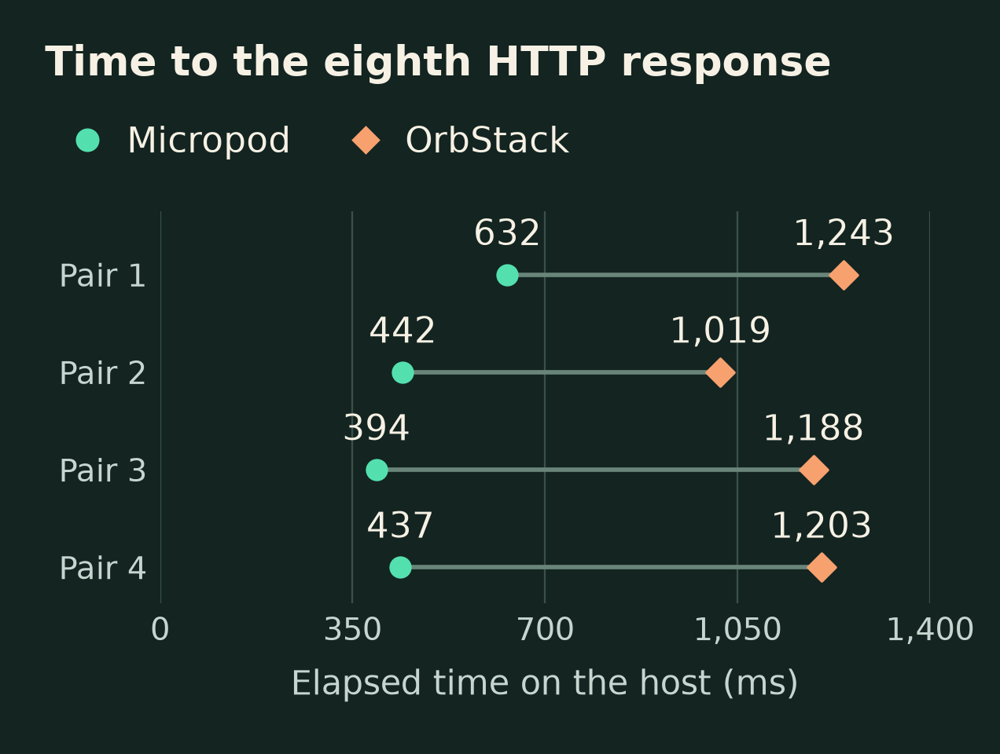

Docker gave a restarted container its old IP address. DNS resolved its name. The container next door still couldn't reach it. Its ARP table remembered the hardware address from before the restart, and Micropod had assigned a new one. Deriving a stable MAC address from each named endpoint's IPv4 address fixed the failure. It's a good reason to keep the benchmark clock running after `docker run` returns. [Network restart investigation](https://github.com/castlemilk/micropod/blob/7b73d35b25470bf3e611fd828103e813bbcce787/docs/benchmarks/2026-11-26/workspace-reply-wait-and-native-network.md#stock-docker-networking)

Micropod runs Linux containers on macOS. For this work I used its native engine, a Rust virtual machine monitor built on Apple's Hypervisor.framework. The CI containers share a Linux worker and speak the Docker Engine API through a local socket. Gamma, the benchmark Mac, has an 18-core M5 Max and 128 GB of memory. I gave the Micropod worker four virtual CPUs and 4 GiB of RAM. The comparison was OrbStack 2.2.5 on the same machine. [Hypervisor.framework](https://developer.apple.com/documentation/hypervisor) · [Configuration and benchmark summary](/blog/micropod-ci-on-apple-silicon/benchmark-summary.md)

## Time the last HTTP response

Eight stock Docker clients started eight Alpine containers on a named bridge. Each service had half a CPU and 256 MiB of memory. It had to resolve its neighbour by name and fetch the unique body that neighbour served. Both engines already had the same image layers. The host timer stopped when all eight checks passed. A second timer ran through removal of the test resources. [Eight-service driver](https://github.com/castlemilk/micropod/blob/7b73d35b25470bf3e611fd828103e813bbcce787/scripts/bench_named_bridge_ci.py)

The engines took turns going first across four pairs per workload. None of these final runs met the pre-start threshold of 90% host CPU idle. During the service comparison, Gamma averaged just 1.34% idle. During the full checkout comparison it averaged 52.75% idle. Each row below compares the engines in the same workload window. [Gamma timings and host load](https://github.com/castlemilk/micropod/blob/7b73d35b25470bf3e611fd828103e813bbcce787/docs/benchmarks/2026-11-26/workspace-reply-wait-and-native-network-gamma.json)

| Workload | Micropod median | OrbStack median |
| --- | ---: | ---: |
| Eight services, through verified HTTP | 439 ms | 1,196 ms |
| Same services, through cleanup | 780 ms | 1,924 ms |
| Eight overlapping Git checks, measured inside the guest | 296 ms | 330 ms |
| One warm Git status, Go build and test run | 703 ms | 745 ms |
| Same job after an atomic edit on the Mac | 2,028 ms | 2,225 ms |

Micropod saved 756 ms on the service run, about 63%. On the warm checkout it saved 42 ms, about 6%. That checkout had 1,058 tracked files. The build rows add the guest time for `git status`, a Go build and three uncached Go test invocations. Measured from the Mac edit through the verified build, the medians were 2,100 and 2,334 ms. [Checkout fixture and timing boundaries](https://github.com/castlemilk/micropod/blob/7b73d35b25470bf3e611fd828103e813bbcce787/docs/benchmarks/2026-11-26/workspace-reply-wait-and-native-network.md)

## Keeping a Mac checkout warm in Linux

An earlier Micropod build threw away cached file pages whenever Linux reopened a file on a writable host share. A warm Git check could therefore read the same checkout across the VM boundary again. In one trace, Git opened all 1,058 tracked paths. It read 932 of them and memory-mapped the other 126. Timing `read()` alone would miss work done later when Git touched a mapped page. [Git trace](https://github.com/castlemilk/micropod/blob/7b73d35b25470bf3e611fd828103e813bbcce787/docs/benchmarks/2026-11-26/workspace-reply-wait-and-native-network.md#raw-mounted-checkout) · [Linux FUSE I/O modes](https://docs.kernel.org/filesystems/fuse/fuse-io.html)

VirtioFS now lets Linux keep the pages if the file's size, modification time and change time still match. When the file changes, host notifications tell Linux which data to discard. On writable shares, directory entries and file attributes can stay cached for 60 seconds. That requires a working notification queue and two live host watchers, kqueue and FSEvents. If either watcher fails to start, fresh replies expire after 20 ms.

We tested both ways the Mac can edit an open file. After an overwrite in place, the guest had to see the new bytes through an existing memory mapping. After an atomic replacement, a fresh open had to see the new file. The old handle had to keep reading the previous one. [Filesystem changes and watcher tests](https://github.com/castlemilk/micropod/blob/7b73d35b25470bf3e611fd828103e813bbcce787/docs/benchmarks/2026-11-26/workspace-reply-wait-and-native-network.md)

A separate five-round test used a 1,317-file checkout, a fixed engine order and one Go test invocation. The median for eight overlapping Git checks fell from 397 ms on the earlier Micropod build to 133 ms. Opening, reading and closing a warm 16 KiB file fell from 51.32 to 11.42 microseconds. OrbStack still did that operation in 8.88 microseconds. [Before-and-after filesystem measurements](https://github.com/castlemilk/micropod/blob/7b73d35b25470bf3e611fd828103e813bbcce787/docs/benchmarks/2026-11-26/phase-b8-virtiofs-notify-and-keep-cache.json)

## Where scheduling and snapshots paid off

The port relay had to serve new requests while 32 bulk streams were already running. Standard macOS scheduling delivered 7,934 MiB/s. Interactive delivered 6,294 MiB/s and cut the 95th-percentile latency of a fresh request from 10.187 to 6.356 ms. At Interactive priority, two relay workers delivered 6,505 MiB/s and four delivered 5,845 MiB/s. Two also used less host CPU per GiB. Each run started after two consecutive samples at or above 90% host CPU idle. [QoS, worker counts and the preserved 6,573.34 MiB/s baseline](https://github.com/castlemilk/micropod/blob/7b73d35b25470bf3e611fd828103e813bbcce787/docs/benchmarks/2026-11-24/gamma-qos-and-workers/results.md)

Traffic between two containers in the same VM took a different path. A 6 GiB IPvlan transfer ran at 18,325 MiB/s. Switching the Linux guest to CUBIC congestion control with fair queueing raised that to 26,452 MiB/s. All those bytes stayed inside the guest. [In-guest network measurements](https://github.com/castlemilk/micropod/blob/7b73d35b25470bf3e611fd828103e813bbcce787/docs/benchmarks/2026-11-25/phase-b4-results.md)

A cold boot through `docker info` fell from 1.641 s on the original Virtualization.framework configuration to 283 ms on the direct Hypervisor.framework build. An already-initialised worker could resume from a snapshot. Micropod cloned its disk with APFS and mapped its saved memory copy-on-write. Across five serial restores, the median from launching the VM process to a successful Docker ping was 10.68 ms. From that same start, the first Alpine container completed in a median 126.1 ms. That's the clock I'd use for a CI job waiting to execute code. [Cold-boot progression](https://github.com/castlemilk/micropod/blob/7b73d35b25470bf3e611fd828103e813bbcce787/docs/benchmarks/2026-11-25/phase-b3-results.md) · [Snapshot and first-container timings](https://github.com/castlemilk/micropod/blob/7b73d35b25470bf3e611fd828103e813bbcce787/docs/benchmarks/2026-11-25/phase-b5-results.md)

## The Docker workflows that passed

In a separate test, Testcontainers started PostgreSQL 16 with a SQL initialisation script mounted from the Mac. We timed three alternating pairs to the point where PostgreSQL accepted connections. The medians were 863 ms on Micropod and 2,782 ms on OrbStack. Testcontainers' Ryuk process then removed its own resources. Its ten-second grace period brought the full lifecycles to 11.11 and 13.45 seconds respectively. A control from a different session survived the cleanup test. [Testcontainers and PostgreSQL results](https://github.com/castlemilk/micropod/blob/7b73d35b25470bf3e611fd828103e813bbcce787/docs/benchmarks/2026-11-26/testcontainers-ryuk-and-observability.md)

Build caching mattered after the first job, too. An earlier multi-stage C build took 8.030 seconds cold and 1.015 seconds warm. After a worker reboot, BuildKit still reported six cached steps and produced the same binary in 2.833 seconds. [BuildKit cache measurements](https://github.com/castlemilk/micropod/blob/7b73d35b25470bf3e611fd828103e813bbcce787/docs/benchmarks/2026-11-26/phase-b7-real-ci-and-caching.md)

The performance table belongs to the signed package with guest runner `4d0fb3989ee4`. The later build on Micropod's default branch has its own correctness tests. Two stock Docker containers running as different non-root users wrote and read the same bytes through the shared Go cache. Stock Buildx loaded an offline image, returned its exact image ID and reused a build step on the second run. Exporting the image returned the expected bytes. [Merged-engine verification](https://github.com/castlemilk/micropod/blob/7b73d35b25470bf3e611fd828103e813bbcce787/docs/benchmarks/2026-11-26/native-engine-landing-verification.json)

The disposable APFS volume had Spotlight off. A final read-only inspection found zero persistent FSEvents journal bytes. Live FSEvents notifications still told the guest about file changes while the worker ran. [Benchmark storage audit](https://github.com/castlemilk/micropod/blob/7b73d35b25470bf3e611fd828103e813bbcce787/docs/benchmarks/2026-11-26/workspace-reply-wait-and-native-network.md#benchmark-storage-and-original-baseline)

Full Docker compatibility is still open. The pinned Docker API 1.47 comparison matched 16 of 27 groups. Across the fixed suite and extra probes, the tests exercised 49 of 107 operations, including partial coverage. The outstanding differences in the fixed comparison involve version negotiation and discovery, Swarm, and plugins. [Docker API audit](https://github.com/castlemilk/micropod/blob/7b73d35b25470bf3e611fd828103e813bbcce787/docs/benchmarks/2026-11-26/workspace-reply-wait-and-native-network.md#stock-docker-networking)

One change I kept out of the running engine was automatic recovery of a cache after a crash. A second process could clear the first writer's dirty marker. On restart the prototype could then move a cache directory while a live writer still held it. Sharing the Go cache across CI jobs is already useful. Recovering it safely means proving who still has it open. [Cache recovery regression tests](https://github.com/castlemilk/micropod/blob/7b73d35b25470bf3e611fd828103e813bbcce787/docs/research/2026-11-25-phase-b4-plan.md#shared-cache-crash-recovery)
