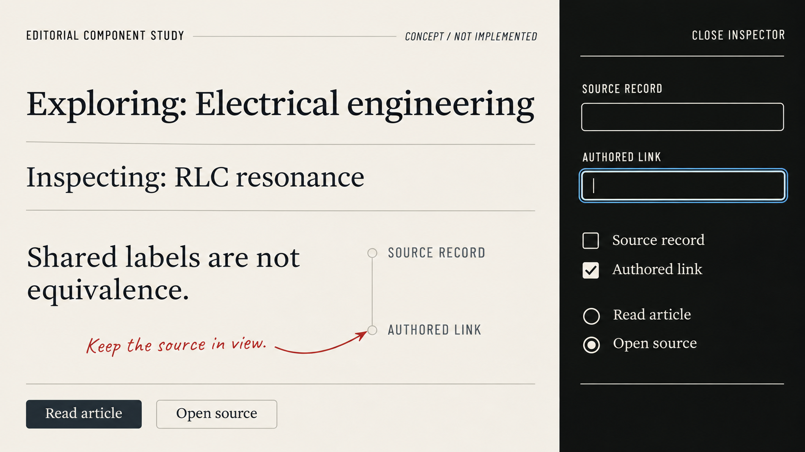
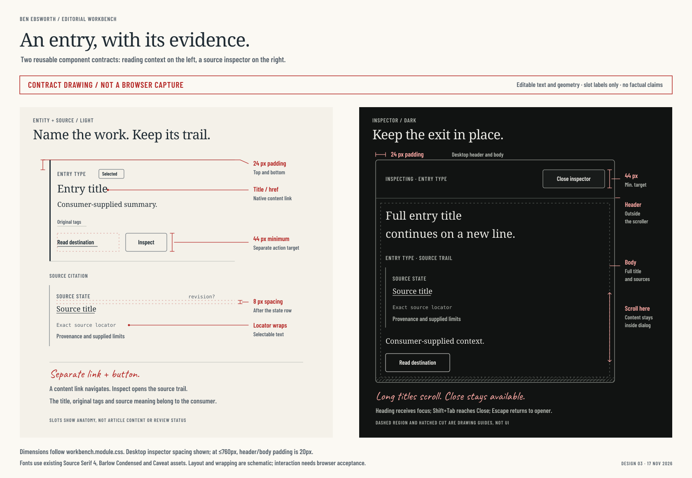

# Original visual studies and critique

These studies continue the selected open-margin research folio. Their purpose is to explain hierarchy, source placement and interaction boundaries. Neither a generated concept nor a specification drawing is a browser capture, scientific evidence or a deployed screen.

## Study A — source-led editorial composition

**Status:** generated concept / not implemented. The original PNG is preserved byte-for-byte. SHA-256: `675ac23a0969e5be185de9443eee096575c1a0d7ea06239ba19d610b9e3eb7c2`. The [exact generation prompt](concept-prompt.txt) records the submitted wording. No input reference image, new category artwork or scientific diagram was used. The image was generated in this Design 03 session; no external source or accuracy claim is attached to it.

The useful ideas are a strong serif opening, narrow technical labels, a continuous source rail, generous open margins and a single purposeful red annotation. A dark inspector reads as another surface in the same editorial language. The implementation keeps those principles through existing font faces, local tokens, ruled entries and a measured folio annotation.

**Rejected details:** the generator depicted “Source record” and “Authored link” as checkbox-like controls, and reading/source navigation as radio-like choices. Those semantics are wrong for this task. Implemented provenance labels are passive text. Destinations are native links; Inspect and Close are separate buttons. The mockup’s imagined control shapes, typography fidelity and wrapping are not accepted implementation evidence.

## Study B — exact component anatomy

[Editable SVG source](component-anatomy.svg). The 1680×1160 PNG was rendered with Inkscape and visually inspected for clipping and overlap. The renderer emitted limited `@font-face` support warnings; this is schematic typography, not browser font acceptance. PNG SHA-256: `8d6d3cbb8e625351f42dcf9e3df75852a6bb5c5c6279055997be0b93a62c536d`.

This editable vector drawing explains local anatomy and spacing. Its fixed geometry is a documentation aid, not proof of responsive rendering. The actual component contract and CSS remain authoritative. Essential names and source locators wrap in implemented components; a compact inspector header keeps Close separate from the scrolling full title and source trail.

## Study C — working composition on the isolated route

`/lab/folio-components/` is the implemented study: navigation context → discovery → evidence-backed relationship language → category vocabulary → reading controls → recovery. The route combines these in a continuous ruled page. It does not introduce a dashboard card grid or replace global navigation.

- **Type:** existing Source Serif 4 reading and headings, Barlow Condensed labels, selectable Caveat notes. Technical metadata uses the existing UI/mono stack.
- **Space:** open margins and section rails; 8/16/24px local rhythm, 44px action targets, a 54ch or 68ch reading sample, and stacked small-screen composition.
- **Marks:** restrained red points to a source or optional reading note. Selection, errors, provenance and focus remain understandable without red.
- **Theme:** local paper/ink pairs, an explicit dark surface and a scope-only inherited option. The adapter does not write site preferences or change About/Hiking.
- **State:** native controls actually alter the fixture or reading sample. Async states are labelled specimens; no hidden fetch or simulated success is presented as real.

## Critique record

The existing repository workflow asks for five separate lenses. `frontend-design` guidance was read. Available Impeccable guidance and its audit reference were read; its context launcher was absent in this environment, so no executed Impeccable audit or score is claimed. The unavailable design-taste-frontend, gpt-taste and Hallmark tools are manual lenses only.

| Lens | Concrete observation | Severity and response | Evidence boundary |
| --- | --- | --- | --- |
| Design-taste-frontend — manual | A reader must know the exploration root and inspected entry simultaneously. | Medium: keep two explicitly named values; inspecting/filtering does not reroot. | Source and DOM assertions. Full-screen rhythm remains visually unverified. |
| GPT-taste — manual | Repeating boxed panels would obscure the reading hierarchy. Generated checkbox/radio semantics would misstate actions. | Medium: ruled open entries and passive metadata; native links and separate actions. | Concept inspected, source reviewed. No claim of rendered polish. |
| Frontend-design — applied guidance | Long source paths and titles are expected; the inspector’s original fixed title could consume a short viewport. | High: full title moves into the scroll body; a compact Close row stays separate. | Source correction and authored short-viewport browser checks. Actual rendering pending. |
| Impeccable — guidance/source review | Delayed native close events and removed openers can break focus return; a missing URL is not a missing print locator. | High: ignore stale close events while open, restore a connected opener/latest fallback, preserve recorded print locators. | Focus/citation DOM regressions pass. Native top-layer behavior remains browser-dependent. |
| Hallmark — manual | Existing annotation CSS could leave a blue note on the local dark surface. | Medium: explicitly scope Caveat note ink to the restrained-red local token. | Source verified. Actual dark rendering remains pending. |

## Browser evidence contract

Six authored cases cover light/dark at 1280×900 and 390×844, search/reset context retention, native-dialog keyboard/scroll at 390×480, 320px long content and reading controls, reduced motion and forced colours. The long-title stress capture is explicitly synthetic and changes only test-page text; it is not a scientific-content fixture.

When executed, each capture records route, viewport, theme, media, fixture revision and `EXPECTED_SHA`. Captures are named `gallery-view-folio-workbench-*` for the existing CI evidence upload. Until an actual artifact is read, the files are a test plan, not screenshots.

The extension browser timed out and the permitted cloud fallback received `ERR_CONNECTION_REFUSED` for the isolated local preview. No browser acceptance, screen-reader check, 200% zoom check, deployed route or manual local capture is claimed. Follow the [verification receipt](../../development/blog-design-03.md) and [Space page](https://chatgpt.com/space/page_74f855da15cc81919425d848da51513d) for subsequent evidence.
