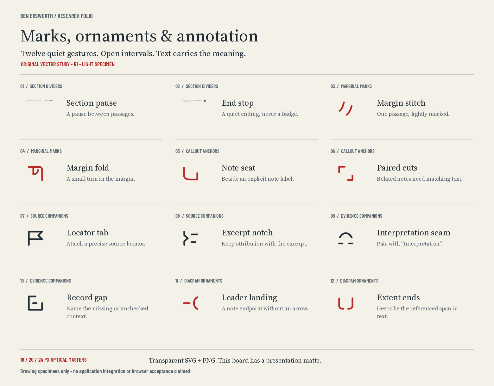

# Blog marks, ornaments and annotation vocabulary

Twelve original small marks extend the open-margin research folio. They use quiet pen turns, unequal lengths and clear intervals; the drawing stays subordinate to the passage, note or source it accompanies. This is a bounded design proposal with editable assets, not a logo refresh or a component implementation.

## Review the work



- [Dark vocabulary](specimens/01-vocabulary-dark.png)
- [Native optical sizes](specimens/02-optical-native.png) and [2× density inspection](specimens/03-optical-density.png)
- [Monochrome and inverse specimen](specimens/04-monochrome.png)
- [Adjacency studies](specimens/05-adjacency-studies.png)
- [Usage and accessibility](USAGE-AND-ACCESSIBILITY.md)
- [Observed review](REVIEW.md), [source audit](SOURCE-AUDIT.md), [provenance manifest](manifest.json), [semantic contract](SEMANTICS.json), [shared-token references](TOKENS.json)
- [Immutable application references](APPLICATION-REFERENCES.json): IDs, revisions, SVG/PNG paths and hashes, dimensions, measured alpha margins, theme policy and caveats
- [Repository checks](validation/repository-checks.md): exact local gate results and execution limits

The six boards are static drawing specimens with presentation mattes. They are not browser screenshots. Every delivered SVG and individual PNG has a transparent canvas.

## Inventory

| ID | Mark | Intended role | Required restraint |
| --- | --- | --- | --- |
| MO01 | Section pause | A quiet pause between passages | Decoration; no broken-axis or numerical meaning |
| MO02 | End stop | Closing flourish | Decoration; no badge or identity role |
| MO03 | Margin stitch | One marked passage | Keep away from code and mathematical operators |
| MO04 | Margin fold | A compact marginal turn | No navigation, save or bookmark affordance |
| MO05 | Note seat | Companion to a note label | Retain the visible label and existing callout behavior |
| MO06 | Paired cuts | Companion to related note labels | Visible matching text supplies the relationship; never a control |
| MO07 | Locator tab | Companion to a source locator | Presence of a locator does not verify a claim |
| MO08 | Excerpt notch | Companion to an attributed excerpt | Source metadata only; never an equation or code token |
| MO09 | Interpretation seam | Companion to the existing Interpretation label | No independent evidence, implication or causality claim |
| MO10 | Record gap | Companion to a stated source gap | The exact text supplies which context is missing or unchecked |
| MO11 | Leader landing | Optional non-arrow annotation endpoint | Existing measured connector owner supplies the relationship |
| MO12 | Extent ends | Optional terminals around a referenced region | No dimensions, error bars, ports or data edges |

MO01–MO12 identify twelve concepts. Optical sizes and palettes are variants of those concepts, not additional original artworks. None is a selected or approved replacement for an existing mark.

## Drawing and optical construction

The smallest master is drawn at 16px, with a 1.5px stroke and broad open counters. The 20px master uses a 1.65px stroke; 24px uses 1.75px. Each has its own coordinates. The larger forms gain curvature and longer returns without shrinking their gaps into fine-detail noise.

Ten marks use square 16/20/24px canvases. The two dividers use 64×16, 80×20 and 96×24 canvases. Do not squeeze the wide dividers into square icon slots. At the reviewed sizes every individual PNG retains at least two fully transparent edge pixels. Preserve that whitespace when placing the asset.

Geometry is identical across the light, dark and monochrome palette variants of each optical size. Each mark uses one color. Standalone files resolve the colors explicitly; future runtime adaptation may use the existing `currentColor` pattern after the component owner reviews the embedding.

The distinction from the established Rough.js gestures is deliberate. These tiny marks have one controlled contour rather than double-stroke roughness that can become indistinct at 16px. They retain the folio’s slight asymmetry and soft turn, while the existing arrows, underlines, brackets, circles, callout icons and insight rail keep their own geometry and purpose.

## Files

- `public/artwork/marks-ornaments-v1/svg/{light,dark,mono}/`: **108 editable SVGs** — 12 concepts × 3 optical sizes × 3 palettes. The light variants are the primary editable masters; the other palettes preserve their geometry.
- `public/artwork/marks-ornaments-v1/png/{light,dark,mono}/`: **216 transparent PNGs** — every master at 1× and 2× density. At 16px the `@2x` file is 32px high and should be displayed at 16 CSS px by a future consumer.
- `specimens/`: six review boards and 36 enlarged transparent details. Enlarged details demonstrate construction, not small-size acceptance.
- `geometry.json`: editable path coordinates, individual briefs and optical notes.
- `make_assets.py`, `render_assets.mjs`, `make_specimens.py`: deterministic authoring and review reproduction. These are packet tools only; no application imports are added.
- `validation/`: structural audit, alpha/render measurements, contrast pairs, reproducibility and independent review receipts.

## Provenance and semantic boundaries

The masters are original, AI-assisted authored vector paths. No raster concept was generated or traced. No third-party logo, scientific figure, category artwork or archived symbol was incorporated. Style references and the exact source baseline are recorded in [SOURCE-AUDIT.md](SOURCE-AUDIT.md).

The fold, seam, seat and tab are visual metaphors. They are not physical models, mathematical constructions, simulation results or data-derived marks. The packet adds no “verified” symbol. Existing labels remain authoritative: **Measured result**, **Simulation**, **Illustration**, **Interpretation**, and the separate source contexts **Source recorded**, **Not yet checked**, **Source unavailable**, **Locator missing**.

There is no font or lettering inside any master. The specimen boards use the repository’s existing Source Serif 4, Barlow Condensed and Caveat font files; those fonts are not copied into this packet. No new license is attached to existing source assets or to the repository.

## Owned scope and coordination

Repository: `castlemilk/benebsworth.com`; baseline `e1c0f0a4c9ac4d7d189542e7c71abf274cc0977e`; isolated branch `art/blog-marks-ornaments-v1`.

Only these new paths are owned by this lane:

```text
docs/design/marks-ornaments-v1/
public/artwork/marks-ornaments-v1/
```

Editorial illustration, additional category motifs and application layouts retain their separate owners. All three owners acknowledged the non-overlapping paths and existing palette/reference contract in the canonical index or their child pages, and the marks owner reciprocated. The current dated receipts remain in Space; they do not approve shared-file integration. The proposed label spacing and accent-density restraint in TOKENS.json belong to this packet only.

Existing fifty category originals, runtime derivatives, canonical category marks, provenance records, graph/Hardware work and other design workbenches remain outside this diff. Nothing imports this packet. A review branch in this public repository is public source; draft status does not make it private. Deployment would also expose files under `public/` at site URLs. No merge, preview setting change, production deployment or release approval is included.

## Reproduce

Use already installed Python, Pillow, FontTools and Sharp. From the repository root:

```bash
python3 docs/design/marks-ornaments-v1/make_assets.py
SVG_RENDERER_ROOT=/path/to/project-with-sharp node docs/design/marks-ornaments-v1/render_assets.mjs
python3 docs/design/marks-ornaments-v1/make_specimens.py
```

`CODEX_PRIMARY_RUNTIME_NODE_MODULES` is an alternative renderer location supported by the review environment. No dependencies are installed by these commands. `make_specimens.py` reads the existing repository editorial fonts and writes temporary converted font data outside the repo. Reproduction with different renderer/font libraries may change PNG bytes; SVG bytes are deterministic for the same source.

Before treating these as integrated UI, the consuming owner still needs real-browser, keyboard, assistive-technology, forced-color, zoom/reflow and print checks at the actual placement. The packet’s static review does not close those gates.
