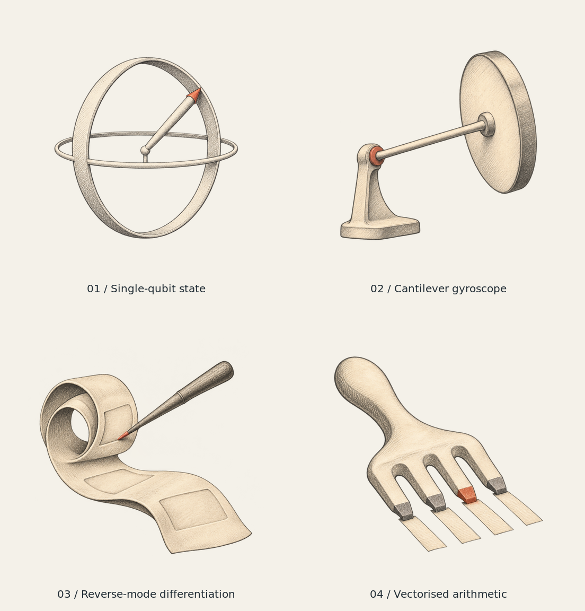
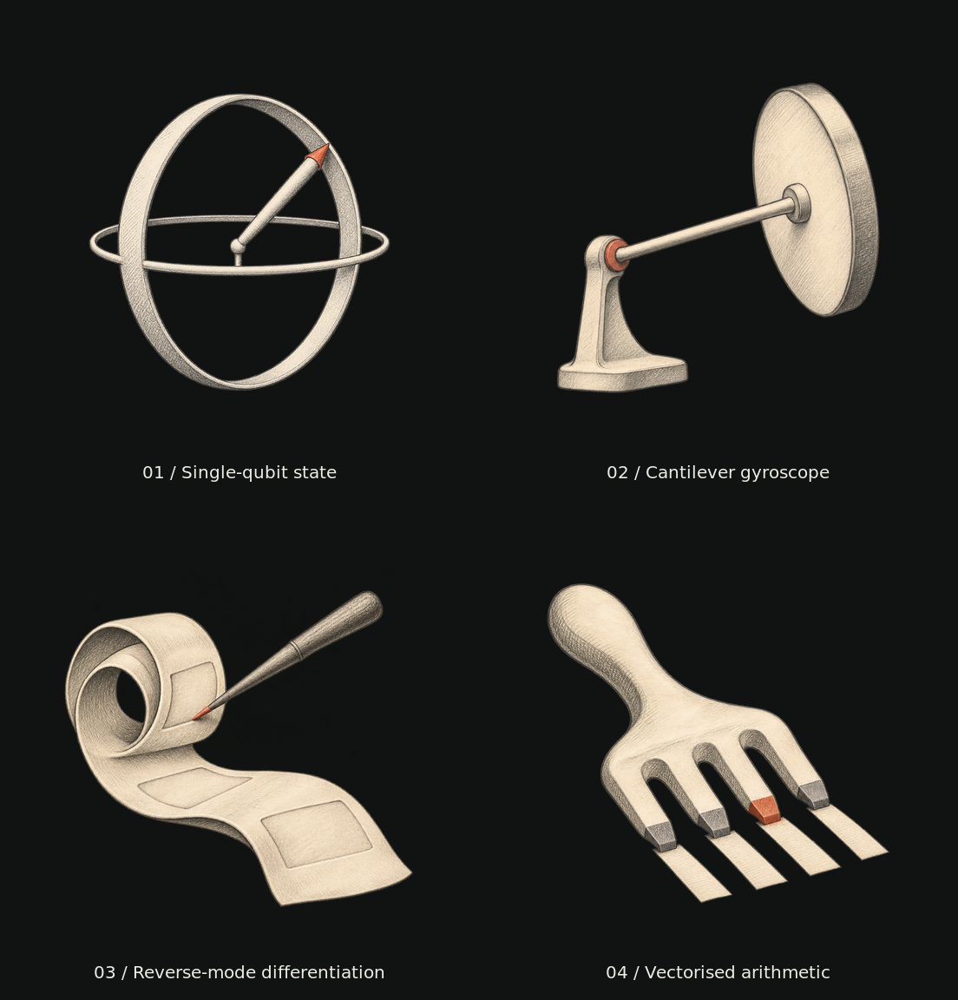

# Blog knowledge-subject motifs — four original candidates

**BSM-20261117 · revision r1 · 17 November 2026**

Four new subject illustrations extend the blog’s current knowledge coverage: single-qubit state, a cantilever gyroscope, reverse-mode differentiation and vectorised arithmetic. They were selected only after auditing the existing fifty category originals and the current article, Lab and study inventory. Every current broad topic already has preserved artwork, so this packet proposes specific subject associations rather than more category replacements.

These are assistant-selected candidates for Ben’s review. They are not yet rated, adopted into a taxonomy or assigned by a runtime registry.

## The bounded set

| ID | Subject | Why this construction earns a place |
| --- | --- | --- |
| `BSM-20261117-01` | Single-qubit state | An open meridian/equator scaffold and a single pointer distinguish state orientation from the existing atom, globe and black hole. |
| `BSM-20261117-02` | Cantilever gyroscope | A single off-centre rotor, axle and end support give the spin/torque subject a distinct asymmetric silhouette. |
| `BSM-20261117-03` | Reverse-mode differentiation | A retained roll of blank computation panels with a revisiting stylus makes saved intermediate work visible without another graph, pipeline or memory stack. |
| `BSM-20261117-04` | Vectorised arithmetic | A shared four-nib tool over separate strips expresses one coordinated operation across multiple elements without another processor, grid or conveyor. |

Each image is an illustration, not a measured result, simulation, scientific figure, working instrument or third-party logo. The [gap map](gap-map.md) records exact source relevance, rejected duplicate concepts and the scope of the comparison. The [usage rules](USAGE.md) define the limits of each metaphor.

## Review sheets

These sheets are static asset examples. Their utility labels and two-by-two arrangement are not an application-layout proposal. The receiving colours come from pinned `app/globals.css`; the original artwork has no background.

## Packet contents

- Four untouched **1254 × 1254 RGBA PNG originals**, under `public/artwork/subject-motifs-v1/originals/`.
- Sixteen transparent full-canvas thumbnails: **64, 128, 256 and 512 px** for each original.
- Light/dark 512 px specimens, contact sheets and 64/128/256 px size sheets.
- [Asset manifest](manifest.json): stable IDs, revisions, source associations, caveats, descriptive text, dimensions, alpha measurements and SHA-256 hashes.
- [Exact generation requests](generation/requests.json) and [generation/derivative receipts](generation/receipts.json). No reference images were supplied. Model version and seed were not exposed by the tool and remain unknown.
- [Source audit](audit/source-audit.json): all fifty prior selected originals verified byte-for-byte, inventory counts and pinned source hashes.
- [Review findings](REVIEW.md), [ownership handoff](OWNERSHIP.md), and [publication status](PUBLICATION.md).

The originals are raster artwork. The artistic-transparent-vectors skill informed silhouette, semantic integrity and visual QA; this packet does not claim editable vector geometry. The beneb design-direction skill informed restrained material, contour and negative-space choices in the blog’s existing folio direction.

## Practical use

Use **128 px or larger** for labelled thumbnails, and **256 px or larger** when the object relationships matter. The 64 px files are decorative previews beside a subject label; their internal details are not reliable explanatory content. Preserve the complete canvas, original colours and alpha. Choose the receiving surface instead of inverting or recolouring the object.

The visible spacing is generous, but the raw files do not satisfy a strict empty 16% border: meaningful alpha bounds leave **10.61–15.55%** minimum margins and every original contains faint outer-edge residue up to **1/255 alpha**. The untouched source files and these measurements are both retained. There is no claim of perfectly empty borders.

## Scope

This branch owns only `docs/design/subject-motifs-20261117/` and `public/artwork/subject-motifs-v1/`. Existing category art and provenance, editorial grammar, marks, application layouts, graph/Hardware work and release controls remain separately owned. Shared adoption requires those owners’ agreement and the existing review path.

[Canonical design Space](https://chatgpt.com/space/page_6adc74403d50819193fb9b2d0681ea64) · [Workstream index](https://chatgpt.com/space/page_ba64e3a87b908191b185bdfc76e46171) · [This packet’s receipt](https://chatgpt.com/space/page_f4d21b4bea7c8191859dfbdc4e638812)
