# Kolibri: Study Packet

This packet follows a token through Kolibri, then traces how Aleph Alpha trained and evaluated the model. The worked examples are calculations from the published configuration. Performance results come from the authors. [Technical report](https://aleph-alpha.com/downloads/tech-report.pdf) · [HTML edition](https://arxiv.org/html/2610.31945v1) · [Checkpoint configuration](https://huggingface.co/Aleph-Alpha/Kolibri-1/blob/main/config.json)

## Thesis

Kolibri is an English and German decoder-only transformer. It spends computation in three different ways: attention reads other positions, a router picks the feed-forward weights to use at each position, and optional reasoning generates additional tokens before answering. Each choice affects a different serving budget. Follow one token through those choices first, then use the training and evaluation sections to understand what the model learned and where the evidence runs out.

> **Start here**
> Read the token walkthrough and the two worked budgets first. Amber dotted marks have extra explanations you can open by hovering, tapping or using the keyboard. The figure guide collects the report's original charts in reading order.

## Guided notes

### Follow one token through the model

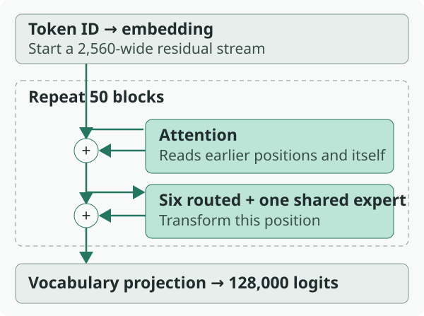

1. **Turn text into IDs.** The tokeniser splits the prompt using a vocabulary of 128,000 entries. Each token ID looks up a learned vector of width 2,560. The vector becomes that position's initial state in the residual stream.
2. **Read the relevant past.** Attention projects the current representation into queries, keys and values. The query represents what the current position is looking for. Keys decide which positions match, and the values supply the information. The causal mask limits a token to its own position and earlier ones.
3. **Transform the resulting token.** After attention updates the stream, the router scores 384 routed experts. Six of those experts and one shared expert each transform that position's vector. Their outputs are summed back into the stream. Expert networks process individual positions. Attention is how positions exchange information.
4. **Repeat the block 50 times.** Both the attention and expert branches read through RMS normalisation and normalise their output before adding it back. Aleph Alpha calls this sandwich normalisation. The skip path carries the previous representation forward, and the branches contribute updates.
5. **Predict the next token.** The final representation goes through an output projection to produce a logit for each vocabulary entry. The generation algorithm selects a token, appends it and repeats. A reasoning trace and a final answer both consume generated tokens.

In the report's architecture drawing, follow the residual stream from bottom to top. The centre shows its two updates, and the insets show what happens inside attention and the expert layer. Orange indicates the pieces unique to a sliding-window layer. [Report Figure 4 and Table 2, pp. 7–8](https://aleph-alpha.com/downloads/tech-report.pdf#page=7)

### Sparse capacity and routing

Each expert is a gated feed-forward network. Two projections take the 2,560-wide input to 512 channels. A SiLU gate modulates one projected vector with the other, and a third matrix projects back to 2,560. The router is a separate learned projection. It gives each expert a logit for the current token, adds an expert-specific bias for selection, and takes the six highest adjusted logits. The selected experts' outputs are weighted by the sigmoid of their **original** logits. The weights are used as computed, with no division by their sum. The shared expert always runs and its output is added separately.

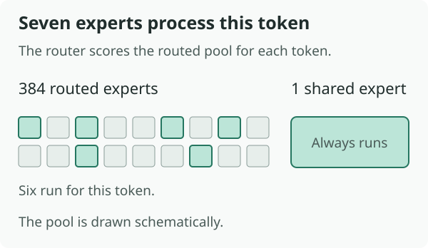

> **A router you can calculate by hand**
> Imagine selecting two of three experts. Their raw logits are 2, 1 and 0. Adding selection biases of 0, 0 and 3 ranks them C, A, B. The output combines A at sigmoid(2) ≈ 0.88 and C at sigmoid(0) = 0.50, plus the shared output. C wins a slot because of its bias, but its weight still uses its raw logit. The two routed weights sum to about 1.38.

**The parameter ledger.** One expert has roughly $3\times 2560\times 512=3.93$ million matrix weights. Across 50 layers, the 384 routed and one shared expert per layer account for about **75.69B** stored weights. Executing only seven per layer uses about **1.38B** expert weights for a token. Add about **1.70B** attention projection weights, **49M** router weights and **328M** output projection weights, and you get approximately **3.46B** active parameters. Total storage also includes the input embedding and normalisation weights. The report excludes the input embedding from its active count. The **4.4% active share** (The count describes one token's path. A batch can collectively touch many experts, and the model has to keep their weights accessible.) is a parameter ratio and cannot serve as a latency estimate.

**Balancing the step and the microbatch.** With $T$ tokens and six assignments per token, perfectly even routing would send $6T/384$ assignments to each expert. For 1,024 tokens that is 16. An expert with 24 assignments is 50% over target, giving MaxVio of at least 0.5. During pre-training, Exact Quantile Balancing (EQB) updates selection biases using score cutoffs across the global optimiser batch. It finds the exact cutoff for the adjusted BF16 values by combining two histograms across ranks, one for each byte. Load-Error Injection (LEI) adds a bounded correction derived from the local load error to the router's score gradients. For example, two microbatches can overload different experts and still look balanced when summed. LEI gives the router a signal for that smaller timescale.

> **A busy expert can contribute very little**
> The authors replaced or silenced routed experts one layer at a time at a production checkpoint. For the first two layers, the measured held-out loss barely moved. The router was making assignments, but those routed outputs had little effect in that test. Check expertise by perturbing the output as well as counting assignments.

[Report §2.1.4–2.1.5 and Appendix B.6](https://aleph-alpha.com/downloads/tech-report.pdf#page=14)

### Attention and long context

**Grouped-query attention (GQA).** Each layer has 48 query heads and four key/value heads of dimension 128. Each group of 12 queries shares a key/value head. The model can ask 48 learned questions at each position while storing four sets of past keys and values. Attention queries and keys get per-head RMS normalisation, which helps control the scale of dot products during training.

**Two attention spans.** Layers 1–4 use sliding-window attention, layer 5 uses full attention, and this pattern repeats ten times. A windowed layer can read the current position plus 512 preceding tokens. Its query and key vectors use rotary position encoding (RoPE), which changes their dot products with relative position. The full layers can read the entire causal prefix and add no RoPE of their own. Their inputs already carry information from earlier windowed layers. At position 1,000 in zero-based indexing, a local layer can directly read positions 488–1,000. A global layer can read positions 0–1,000. Lower layers can also pass information forward indirectly through other positions.

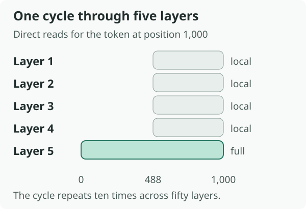

**Prefill and decode.** During prefill, the model processes the prompt and fills the attention cache. Full causal attention compares roughly $N^2/2$ query/key pairs per head across a prompt of length $N$. A windowed layer uses at most about $513N$. Since ten layers still use full attention, the hybrid keeps a quadratic attention term in prefill. During decode, each new query reads the stored keys and values for its layer's span. Full layers continue growing with context, while a runtime that evicts old local entries can cap the local layers' storage.

**Worked cache budget.** Each cached position in one layer stores $2\times4\times128=1{,}024$ numbers for keys and values. With one byte per number and a 513-slot local allocation, the idealised single-request budget is:

$$
M_{\mathrm{KV}}(N) = 1024\left(10N + 40\min(N,513)\right)\ \mathrm{bytes}.
$$

At 262,144 live tokens, that is **2.52 GiB** versus **12.50 GiB** for 50 full layers with the same heads and precision. At 1,048,576 tokens the hybrid reaches **10.02 GiB**. Double those idealised numbers for two-byte KV data. Add weights, allocator overhead, quantisation state and other buffers separately. The model card's approximately 78 GB FP8 weight figure covers a different budget. GB measures decimal billions of bytes and GiB uses powers of two.

Aleph Alpha compared hybrid and full attention in a FLOP-matched proxy and trained the hybrid on four times the sequence length in that setup. The authors also ran window-size sweeps with matched resource budgets, then checked selected candidates at a larger scale. The production model used 512 previous tokens. The report's **one-million-token evaluation** (The base model trained to 262,144. The longer evaluations probe extrapolation, and different tasks fail at different rates.) tests several RULER tasks. Variable tracking holds up better than word extraction, and the post-trained model's results also vary with reasoning mode. The publisher recommends at most 262,144 tokens for complex or latency-sensitive use. [Report §2.1.3, Figures 7–9](https://aleph-alpha.com/downloads/tech-report.pdf#page=12) · [Figures 18 and 65](https://aleph-alpha.com/downloads/tech-report.pdf#page=43) · [Model card](https://huggingface.co/Aleph-Alpha/Kolibri-1)

### Why German changes the tokeniser and the data

Ordinary byte pair encoding (BPE) builds a vocabulary bottom-up by repeatedly merging a frequent adjacent pair. UniBPE also builds by merging pairs, but asks which candidate would improve the corpus likelihood most under a unigram model. The unigram model scores each token using its frequency in the segmented corpus. A merge changes the counts of its parts, the count of the new token and the total number of tokens. That gives UniBPE a different criterion from pair frequency alone.

To see why segmentation matters, consider the German compound *Krankenhausverwaltung*. A boundary between *Krankenhaus* and *Verwaltung* preserves two recognisable units. This is an illustration of morphology, and actual splits depend on the tokeniser. On the paper's 1,000-word German morphology set, 65.2% of Kolibri's predicted boundaries align with a labelled morpheme boundary, versus 47.3% for the GPT-5 tokeniser used by the authors. On their separate German web sample, Kolibri uses 11.2% fewer tokens than that comparator. A vocabulary ablation at equal size finds similar bits per byte for plain BPE and UniBPE, with better retrieval recall for UniBPE in the tested proxy. Better compression or morphology alone cannot establish better answers on a German task.

**Compare text in the same units.** Bits per byte divides the model's surprise by the number of text bytes, so a different segmentation does not change the denominator. Decoded bytes per second does something similar for output volume. If a 1,000-byte passage uses 200 tokens with one model and 250 with another, both could report 100 tokens/s while delivering 500 and 400 bytes/s respectively. That is an illustration. Different output languages or verbosity can still change bytes per successful answer. [Report §2.1.2, Figures 5–6 and Appendix B.1](https://aleph-alpha.com/downloads/tech-report.pdf#page=9)

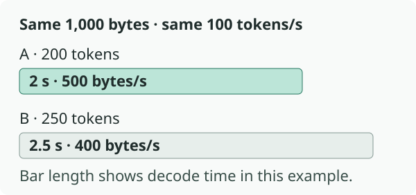

### From raw data to Kolibri Base

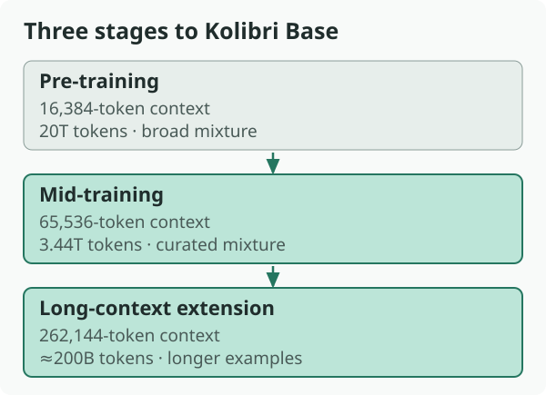

| Stage | Tokens processed | Sequence length | Job |
| --- | ---: | ---: | --- |
| Pre-training | 20T | 16,384 | Learn next-token prediction on a broad mixture. |
| Mid-training | 3.44T | 65,536 | Shift toward curated reasoning, code and instruction-style text. |
| Long-context extension | About 200B | 262,144 | Train on examples that make the longer sequence useful. |
| Supervised fine-tuning | About 268B packed tokens | 262,144 packed | Teach the base model how to respond as an assistant. |
| Reinforcement learning | More than 1.2M curated tasks in the environment mix | Varies by task | Improve behaviour using feedback from sampled attempts. |

The first three stages produce **Kolibri Base**. They continue the next-token objective under different data mixes and sequence lengths. The ≈24T headline rounds their total. The SFT row counts packed sequence tokens. The RL row counts tasks available in the mix, a different unit from either tokens or completed rollouts. [Report Figure 3 and §§2.3, 3.1.4, 3.2.2](https://aleph-alpha.com/downloads/tech-report.pdf#page=6) · [Model card](https://huggingface.co/Aleph-Alpha/Kolibri-1)

**Pre-training data.** A pool of 78 datasets spans nine domains, including web text, technical documents, code and instruction data. The authors report about 29.3T materialised tokens in the pool and select 20T for the run. They filter and deduplicate crawl data, apply language-specific rules, redact some personal information and use synthetic rephrasings and translations to extend scarce sources. The report attributes about 4.8T of the pre-training tokens to synthetic origins. Its §2.3.2 gives a 21.3% German share of final pre-training tokens. The model card's approximate mixture lists 23.9% German. The sources give different percentages, so retain each with its source rather than combining them. The report's governance discussion documents the authors' screening and due diligence process. [Report §2.3.2 and Appendix D.1](https://aleph-alpha.com/downloads/tech-report.pdf#page=24) · [Model card](https://huggingface.co/Aleph-Alpha/Kolibri-1)

**Mixture selection.** The team used short runs to test candidate mixes, then evaluated some both as base models and after a small SFT stage. In the 400B-token continuation experiment, their production mix candidate scored 65.5 versus 60.6 for continued pre-training on the base aggregate, and 51.3 versus 39.7 after SFT. TriviaQA dropped from 63.5 to 55.0 and German HellaSwag from 77.6 to 70.4 in that same comparison. A better average can hide regressions on individual tasks. [Report Table 14](https://aleph-alpha.com/downloads/tech-report.pdf#page=37)

**Long-context data.** Filling a large training sequence with independent short documents gives few examples that require connecting distant passages. The authors mix in naturally long documents and reweight curated sources toward longer examples. This changes the subject mix as well as the length distribution: long web and scanned documents gain share while short instructions and agentic examples lose share. The authors compare a control and several reweighting settings, then select the one-third setting for the production recipe. Raw loss values across the three stages reflect different data distributions, so compare checkpoints on a common evaluation. [Report §2.3.4, Figures 15–17](https://aleph-alpha.com/downloads/tech-report.pdf#page=38)

### Optimisation and the training cluster

The production run groups model weights by their role. Muon updates the attention and expert matrices by rescaling the momentum direction using an approximate orthogonalisation. Adam updates embeddings and normalisation scales. AdamW updates the output head and router, with decoupled weight decay. The learning rate warms up over the first 100B tokens and then stays stable through base training. The base release averages the last 20 checkpoints of the long-context stage. Checkpoint averaging combines weights from one trajectory, whereas the later SFT soup combines separately trained endpoints.

Tuning at full size would consume a large fraction of the training budget. The team keeps depth at 50 and tunes narrower models, then separately extrapolates loss curves from shorter runs to pick a learning rate for the target horizon. In the reported sweep, a high learning rate could look good early while a smaller one was forecast to win by 20T. The extrapolation guides the choice and inherits the limits of the proxy and fitted curve. Architecture experiments likewise use smaller M and L models, matching the resources relevant to each question, such as forward FLOPs and cache capacity in a window sweep. [Report §§2.1.1 and 2.2, Table 6 and Figure 10](https://aleph-alpha.com/downloads/tech-report.pdf#page=18)

The report describes 768 B200 GPUs across 96 nodes for pre-training, organised as expert parallelism 8 × fully sharded data parallelism 16 × data-parallel replicas 6. Within each eight-GPU node, expert parallelism places experts on different devices and dispatches token activations to the devices that own them. Across nodes, fully sharded data parallelism divides weight and training state storage among ranks. Data-parallel replicas handle different batches and synchronise updates. In the detailed architecture section, both later base-training stages use FSDP 128 × DP 6. The model card lists the mid-training layout differently, so use the report's layout when reading its infrastructure description. [Report §2.1.6 and Appendix B.7](https://aleph-alpha.com/downloads/tech-report.pdf#page=18) · [Model card](https://huggingface.co/Aleph-Alpha/Kolibri-1)

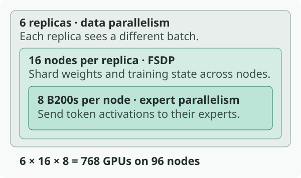

### Supervised fine-tuning and the reasoning dial

A base model learns to continue text. Supervised fine-tuning (SFT) trains on desired assistant responses, including reasoning traces, tool calls and retrieval answers. For long-context SFT, the authors start with a document of roughly 128k–224k tokens and build a conversation with four requests whose answers draw on different parts. For tool use, they add reasoning around certain failed calls and mask the loss on the incorrect action. The later recovery remains a training signal. For German reasoning, they describe artefacts from directly translating traces and instead train on examples where the teacher reasons in German. [Report §§3.1.1.1–3.1.1.4, Figures 21–23](https://aleph-alpha.com/downloads/tech-report.pdf#page=53)

**Effort as a learned control.** The same checkpoint can answer directly or use low, medium or high reasoning effort. The chat template includes a system sentence expressing the requested effort. For training traces, the team compares reasoning length with the 30th and 70th percentiles of traces with the same dataset and judged difficulty. The assignment softens near the cutoffs. Traces with no reasoning get the none label. Higher effort gives the model room to reason and tends to increase generated tokens. The prompt can still influence the length, so treat the setting as a behavioural control rather than a fixed token limit. Compare modes on task success, time and total generated tokens. [Report §3.1.2.2, Figure 26 and Table 19](https://aleph-alpha.com/downloads/tech-report.pdf#page=61)

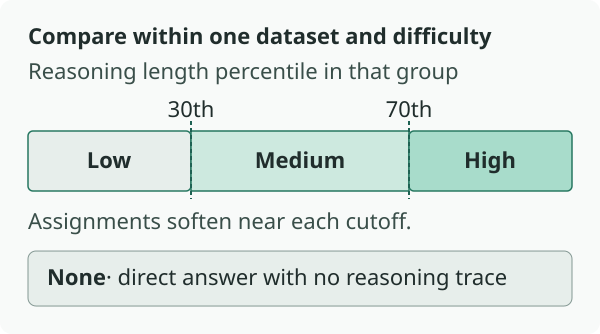

**Which mix, and how to pack it.** MergeMix uses weight averages of specialist models to explore candidate SFT data weights before training promising candidates on mixed data. In the broad sweep, six of seven alternatives beat the trained baseline, yet the top weight merge trained worst and rank correlation was −0.09 over the six candidates with both ranks. Use proxy searches to find candidates, then verify them by training. Separately, SFT packs several conversations into each long sequence and masks attention across boundaries. Equal token counts can conceal unequal work. One conversation of 4,096 tokens has roughly four times the full-attention pair count of four independent 1,024-token conversations. The authors report an 84% throughput gain from ordering packed sequences by attention cost in their SFT setup. [Report §§3.1.3–3.1.4, Table 22](https://aleph-alpha.com/downloads/tech-report.pdf#page=66)

### Reinforcement learning from attempts

1. **Sample a group.** The rollout system tries the same task several times with the current inference policy. A rollout can include multiple tool calls, their responses and a final answer.
2. **Score each attempt.** The task environment gives feedback. A math problem can check an answer, a coding task can run tests, and a retrieval task can assess whether the answer is grounded. Format signals can also change a segment's reward.
3. **Compare with the group.** For the simple case of one segment per attempt, subtract the mean reward from each attempt's reward. If four attempts score 1, 1, 0 and 0, the advantages are +0.5, +0.5, −0.5 and −0.5. The production objective handles multiple segments and gives each sequence equal weight in the baseline. Generated tokens inherit the advantage of their segment. User, system and tool-response tokens are masked from the training loss.
4. **Update a moving model.** Rollouts and training run asynchronously, so the trainer may have moved ahead of the model that generated a rollout. The loss uses the probability ratio between the current training and rollout policies, suppresses updates that move too far in the rewarded direction, bounds gradient influence and penalises large log-ratio shifts. Old groups can also leave the replay buffer before training uses them.
5. **Learn from a group with no successes.** Equal rewards often yield no useful group-relative signal. For selected tool environments, targeted on-policy self-distillation gives the same model a corrective hint at the failed turn and uses its hinted distribution as a teaching signal for the original context. This uses a distillation update for that group in place of its policy-gradient update.

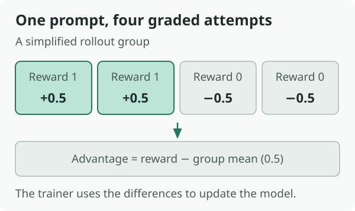

The production run uses 256 B300 GPUs. The system has separate roles for generating rollouts, training, judging and running environments. Slow tasks, ageing groups and tasks that yield no informative scores can all change which data reaches the trainer. This is a sampling issue as well as a scheduling issue. Figure 36 follows the parts across machines and Figure 39 plots reward by environment group. Reward improvement is evidence about those environments. Use held-out evaluation to see whether it transfers. [Report §§3.2.1–3.2.4, Figures 36 and 39](https://aleph-alpha.com/downloads/tech-report.pdf#page=71)

### How the released model scores

Aleph Alpha's released assistant scores **75.5% English** and **70.8% German** on the report's overall post-training suites. Kolibri Origin scores **54.1%** and **46.4%** on the respective suites, gaps of **21.4** and **24.4 percentage points**. Each overall score averages the applicable category means equally. The two languages use different sets of tasks, and long-context results sit outside these aggregates. The release was evaluated at high reasoning effort. [Report §3.3 and Tables 28–29](https://arxiv.org/html/2610.31945v1#Pt3.S3)

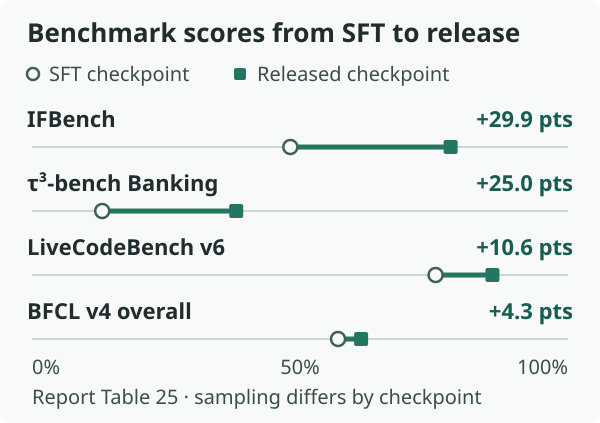

The SFT comparison starts from the checkpoint used to initialise reinforcement learning. Aleph Alpha sampled the SFT checkpoint without top-p or top-k truncation and the released checkpoint with top-p 0.97 and top-k 128. These differences describe the evaluated checkpoints and settings together. Benchmark names link to the original projects. Bars use a shared 0–100% scale, and bold marks the highest reported score among the entries shown in each row. [Report Table 25](https://arxiv.org/html/2610.31945v1#Pt3.S2.T25)

| Benchmark score (%) | SFT | Released | Change |
| --- | ---: | ---: | ---: |
| [IFBench](https://github.com/allenai/IFBench) · loose-prompt | 48.2 | **78.1** | +29.9 pp |
| [τ³-bench Banking](https://github.com/sierra-research/tau2-bench/blob/main/src/tau2/knowledge/README.md) | 13.1 | **38.1** | +25.0 pp |
| [LiveCodeBench](https://github.com/LiveCodeBench/LiveCodeBench) · v6 | 75.3 | **85.9** | +10.6 pp |
| [AA-LCR](https://huggingface.co/datasets/ArtificialAnalysis/AA-LCR) · long-context reasoning | 60.3 | **68.3** | +8.0 pp |
| [LongBench Pro](https://arxiv.org/abs/2601.02872) · 8k–128k | 57.1 | **64.5** | +7.4 pp |
| [GPQA Diamond](https://github.com/idavidrein/gpqa) · science | 79.8 | **84.3** | +4.5 pp |
| [BFCL v4](https://gorilla.cs.berkeley.edu/leaderboard.html) · overall | 57.1 | **61.4** | +4.3 pp |
| [AIME](https://maa.org/maa-invitational-competitions/) · 2025 | 92.7 | **96.9** | +4.2 pp |

**Against other sparse models.** The benchmark winner changes with the task. Kolibri scores above Qwen3.6 35B-A3B and Nemotron 3 Nano 30B-A3B on LiveCodeBench and IFBench. Those two models do better on BFCL multi-turn and RGB Closed-Book. In this report BFCL v4 uses a different web-search backend from the public leaderboard and model-specific sampling, so compare within the report. [Report §3.3.1 and Tables 28–29](https://arxiv.org/html/2610.31945v1#Pt3.S3)

| Benchmark score (%) | Kolibri | Qwen3.6 35B-A3B | Nemotron 3 Nano 30B-A3B |
| --- | ---: | ---: | ---: |
| [GPQA Diamond](https://github.com/idavidrein/gpqa) · English | **84.3** | 83.4 | 73.9 |
| [LiveCodeBench](https://github.com/LiveCodeBench/LiveCodeBench) · v6 | **85.9** | 82.5 | 71.3 |
| [IFBench](https://github.com/allenai/IFBench) · loose-prompt | **78.1** | 66.1 | 73.2 |
| [BFCL v4](https://gorilla.cs.berkeley.edu/leaderboard.html) · overall | 61.4 | **67.2** | 61.5 |
| [BFCL v4](https://gorilla.cs.berkeley.edu/leaderboard.html) · multi-turn | 47.5 | **58.1** | 53.5 |
| [RGB](https://github.com/chen700564/RGB) · Closed-Book | 51.0 | 79.0 | **80.0** |
| [LongBench Pro](https://arxiv.org/abs/2601.02872) | 64.5 | **70.8** | 53.2 |

### What happens as context grows

Aleph Alpha tested **Kolibri Base** on RULER, a synthetic suite of retrieval, variable tracking, word extraction and question answering tasks. Kolibri Base trails both selected peers at 256k tokens, then leads both at 1M. Its own score falls from **69.8% at 256k** to **63.2% at 1M**. Each point averages results across the four RULER task families at temperature zero. At the longer lengths, Kolibri and Qwen run beyond their 256k training windows. Qwen uses static YaRN with factor four throughout the test, and Nemotron supports 1M natively. [NVIDIA RULER](https://github.com/NVIDIA/RULER) · [Report §2.4.3.1 and Table 18](https://arxiv.org/html/2610.31945v1#Pt2.S4.T18)

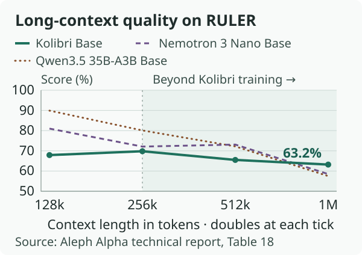

| RULER context (tokens) | Kolibri Base | Nemotron 3 Nano Base | Qwen3.5 35B-A3B Base |
| --- | ---: | ---: | ---: |
| 131,072 | 67.9% | 81.0% | **89.9%** |
| 262,144 | 69.8% | 72.1% | **80.1%** |
| 524,288 | 65.5% | **73.1%** | 72.2% |
| 1,048,576 | **63.2%** | 58.5% | 57.5% |

**The assistant behaves differently.** Figure 65 uses the released checkpoint and its chat template. Turning reasoning off helps needle retrieval, while turning it on helps question answering at the longest contexts. The two modes can generate up to 1k and 16k tokens respectively. That comparison changes the output budget as well as the mode. The model card lists a 1,048,576-token window and recommends staying at or below 262,144 for complex tasks and serving efficiency. [Report Appendix G](https://arxiv.org/html/2610.31945v1#A7.F65) · [Model card](https://huggingface.co/Aleph-Alpha/Kolibri-1)

### Read the evaluations in the right order

**First, choose the checkpoint and task.** Kolibri Base scores **81.1% English** and **81.5% German** on the report's base suites. Its predecessor scores **58.4%** and **61.1%**, respectively. The base and assistant suites use different tasks and protocols, so compare like checkpoints within each suite. Among the German evaluations, some use translated tasks and others use German-specific material. [Report Table 17](https://arxiv.org/html/2610.31945v1#Pt2.S4.T17) · [Report §3.3](https://arxiv.org/html/2610.31945v1#Pt3.S3)

**Then read the frontier.** Figure 1 plots quality against estimated decoded bytes per second per GPU. Its four panels separate training stage and language. A point dominates another if it is at least as good on both axes and strictly better on one. In the toy example below, A and B each dominate C, while neither dominates the other. The report draws a convex-hull guide over the compared points. [Report Figure 1](https://arxiv.org/html/2610.31945v1#Pt0.S0.F1)

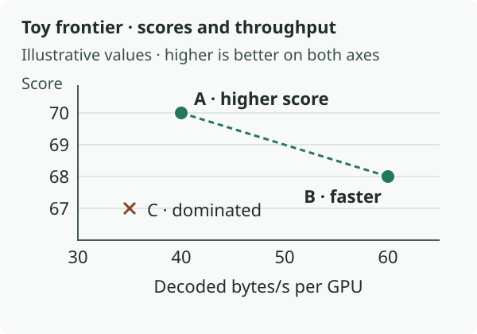

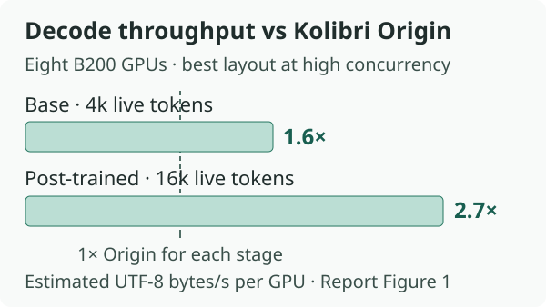

**Read the throughput setup before applying the ratio.** Aleph Alpha ran vLLM with synthetic prompts on eight B200s. They chose each model's fastest measured parallel layout near its cache limit. To estimate UTF-8 bytes per second, they multiplied the measured token rate by bytes per token derived from English or German evaluation prompts. Their estimate depends on how closely those prompts resemble generated output. The headline ratios compare each stage with its corresponding Origin checkpoint at the same context length. They describe saturated decoding. An interactive deployment also needs measurements of prefill, time to first token, tail latency and generated tokens per successful answer. [Report Appendix A](https://arxiv.org/html/2610.31945v1#A1)

**Check what the curve leaves out.** On the authors' Industry RAG proxies, Kolibri averages **89.7%** across the two English tasks and **67.5%** across the two German tasks scored for every model, versus **93.2%** and **80.2%** for dense Qwen3.8 27B. The German aggregate excludes Aerospace, where Kolibri scores **58.9%**. The authors used in-house corpora, tools and judges, and some test sets are small. Compare models within a task before using the score to draw deployment conclusions. The grounding results also distinguish abstaining when evidence is absent from answering accurately without a document. [Report §3.3 and Table 29](https://arxiv.org/html/2610.31945v1#Pt3.S3.T29)

> **Read the HumanEval curves together**
> The authors searched later training pools for benchmark overlaps. Their pre-training pool escaped that evaluation-specific scan. Figure 64 plots HumanEval pass@1 alongside reference-solution recitation and the score on unrecited completions. Read all three curves before treating the pass rate as evidence of general coding ability. Use newly written tasks and inspect outcome traces when evaluating it yourself.

[OpenAI HumanEval](https://github.com/openai/human-eval) · [Report Appendix D.2 and Figure 64](https://aleph-alpha.com/downloads/tech-report.pdf#page=160) · [Authors' follow-up on benchmark contamination](https://aleph-alpha.com/en/blog/generalization-or-memorization-what-contaminated-training-data-does-to-benchmark-scores/)

### How the pieces ship together

Aleph Alpha describes Savanna as a model development system built around version-controlled training, data, evaluation and deployment workflows. The point is traceability across stages: a team can identify which inputs and checkpoint yielded a reported score, retry a failed job from the correct state and attach the same evaluation to different candidate runs. The report describes automatic recovery at scale and continuing from frozen recipe revisions with reviewed changes. The released model card and config can help reproduce inference settings. Rebuilding the model from scratch would require the exact data, training code, hardware and environment state as well. [Report §4 and Appendix B.7](https://aleph-alpha.com/downloads/tech-report.pdf#page=104) · [Release files and licence scope](https://huggingface.co/Aleph-Alpha/Kolibri-1)

### Figure guide

| Report figure | What to look for |
| --- | --- |
| [4 · One transformer block](https://aleph-alpha.com/downloads/tech-report.pdf#page=7) | Trace the residual stream bottom to top. Compare the two insets and find which operations change between attention layer types. |
| [5 · Tokeniser compression](https://aleph-alpha.com/downloads/tech-report.pdf#page=11) | Look at German and English bars separately. The quantity is bytes per token, so higher means denser text packing. |
| [7 · Hybrid vs full attention](https://aleph-alpha.com/downloads/tech-report.pdf#page=12) | Separate pre-training accuracy from the long-context score. Compare the different training lengths in the experimental setup. |
| [3 · Base training stages](https://aleph-alpha.com/downloads/tech-report.pdf#page=6) | Trace the three stages in order. Each has its own token axis and data mixture. |
| [18 · Base model up to 1M context](https://aleph-alpha.com/downloads/tech-report.pdf#page=43) | Compare variable tracking with word extraction and QA. They probe different capabilities. |
| [Table 18 · RULER and HELMET](https://arxiv.org/html/2610.31945v1#Pt2.S4.T18) | Check the checkpoint and context length before comparing rows. |
| [23 · Long-document conversations](https://aleph-alpha.com/downloads/tech-report.pdf#page=57) | Follow the sampled passages back into the assembled document and conversation. |
| [26 · Effort labels](https://aleph-alpha.com/downloads/tech-report.pdf#page=61) | Find the difficulty grading, length percentiles and resulting effort label. |
| [36 · RL cluster layout](https://aleph-alpha.com/downloads/tech-report.pdf#page=82) | Follow requests from rollout workers to inference and outcomes back toward the trainer. |
| [39 · Reward by environment](https://aleph-alpha.com/downloads/tech-report.pdf#page=87) | Look at groups separately. The overall trend can hide differences in when learning takes off. |
| [Table 25 · SFT against release](https://arxiv.org/html/2610.31945v1#Pt3.S2.T25) | Compare gains by task and read the sampling settings in the caption. |
| [1 · Quality and throughput](https://aleph-alpha.com/downloads/tech-report.pdf#page=1) | Read one panel at a time. Check both axes and find the predecessor point. |
| [64 · HumanEval recitation](https://aleph-alpha.com/downloads/tech-report.pdf#page=160) | Compare the overall score, recitation share and unrecited score at the same checkpoint. |
| [65 · Reasoning at long context](https://aleph-alpha.com/downloads/tech-report.pdf#page=167) | Compare reasoning on and off across task types as context increases. |

## The physics

| Quantity | Value | Use |
| --- | --- | --- |
| Width / vocabulary | 2,560 / 128,000 | Residual dimension and size of the next-token logit vector. |
| Total / active weights | 78.1B / 3.46B | Size the weight pool and token path separately. |
| Routed choices | 6 of 384 plus 1 shared per block | Six routed choices, seven executed experts. |
| Query / KV heads | 48 / 4, dimension 128 | Twelve queries per KV head. |
| Local / full layers | 40 / 10 | Full layers still grow in cost as context grows. |
| Local attention span | 512 preceding tokens plus self | 513 positions in the published attention window. |
| Ideal FP8 KV at 256k / 1M | 2.52 GiB / 10.02 GiB per request | Estimate from the layer pattern, assuming local eviction. |
| Training context | 16,384 → 65,536 → 262,144 | Compare with extrapolation to 1,048,576. |
| Pre-training / RL hardware | 768 B200 / 256 B300 | Different stages and workloads. |
| Frontier hardware | Eight B200 GPUs | Normalisation base for the reported throughput comparison. |

## Glossary

- **Residual stream**: The per-position representation updated by attention and feed-forward blocks.
- **Grouped-query attention**: Multiple query heads share each key and value head.
- **Sliding-window attention**: Each query can read a bounded span of recent positions.
- **KV cache**: Keys and values retained so later generation steps can reuse them.
- **Mixture of experts**: A model that routes positions through selected feed-forward networks.
- **Prefill**: Processing the prompt and building the initial cache.
- **Decode**: Generating tokens sequentially from the state and cache.
- **Ablation**: A controlled comparison that changes part of a recipe and measures the effect.
- **Rollout**: An attempt at a task, potentially containing tool interactions and multiple turns.
- **Group-relative advantage**: A reward such as a segment's score minus the baseline from its group of attempts.
- **Pareto frontier**: Candidates for which no compared candidate is at least as good on both axes and strictly better on one.
- **Benchmark contamination**: Training exposure to evaluation material that can make scores less representative of generalisation.

## → Ben's world

- For the LLM benchmark harness, log time to first token, decoded bytes per second, generated tokens and task success separately. Compare reasoning modes on the same tasks and report the actual context range.
- For document analysis, place equivalent evidence near the start, middle and end. Include examples with missing evidence and measure justified abstention alongside retrieval success.
- For model training or serving, chart per-device load and wait times alongside averages. The expert-balancing story is a concrete example of why a shared average can miss the participant setting step latency.

## Open questions

- How far do the 256k and 1M results transfer from synthetic probes to multi-document German retrieval with realistic distractors?
- What is the best quality/latency point for a smaller GPU budget once prefill, cache occupancy and reasoning tokens are included?
- How much of the observed German performance comes from tokeniser design, data selection and post-training respectively at production scale?
- Do fresh coding tasks preserve the ordering seen on the public suite after filtering obvious overlap?

[Local report figure extracts](report-figures/README.md)
