# Kolibri report figures

These 12 crops follow the order of the study packet. The charts and drawings are by Aleph Alpha, from *Kolibri: A Sovereign European Model on the Pareto Frontier*. The PNGs are rasterised and cropped from the supplied PDF. The reading notes below are original. The arXiv edition is marked CC BY-NC-SA 4.0. [Source PDF](https://aleph-alpha.com/downloads/tech-report.pdf) · [arXiv record](https://arxiv.org/abs/2610.31945) · [Licence](https://creativecommons.org/licenses/by-nc-sa/4.0/)

## Figure 4 · One transformer block

Trace the residual stream bottom to top. Compare the two insets and find which operations change between attention layer types. [Source page 7](https://aleph-alpha.com/downloads/tech-report.pdf#page=7)

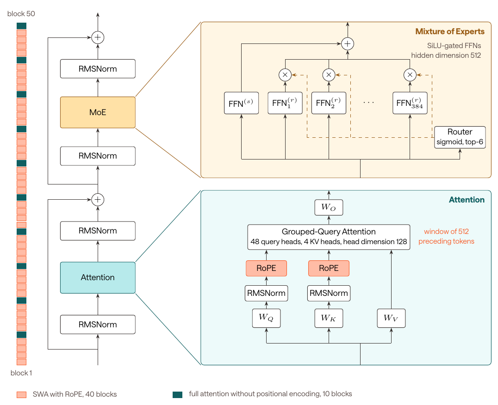

## Figure 5 · Tokeniser compression

Look at German and English bars separately. The quantity is bytes per token, so higher means denser text packing. [Source page 11](https://aleph-alpha.com/downloads/tech-report.pdf#page=11)

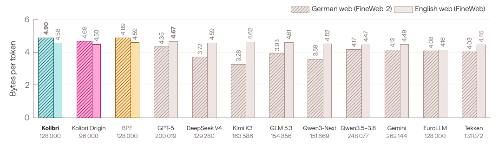

## Figure 7 · Hybrid vs full attention

Separate pre-training accuracy from the long-context score. Compare the different training lengths in the experimental setup. [Source page 12](https://aleph-alpha.com/downloads/tech-report.pdf#page=12)

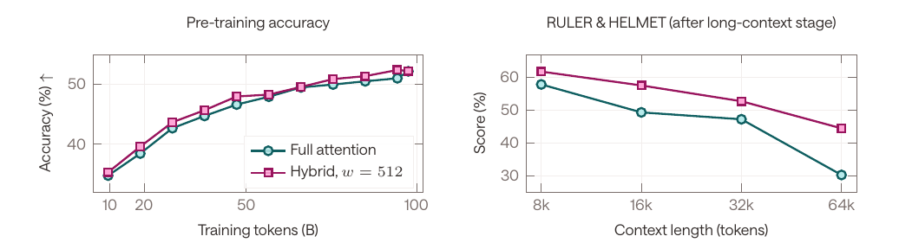

## Figure 3 · Base training stages

Trace the three stages in order. Each has its own token axis and data mixture. [Source page 6](https://aleph-alpha.com/downloads/tech-report.pdf#page=6)

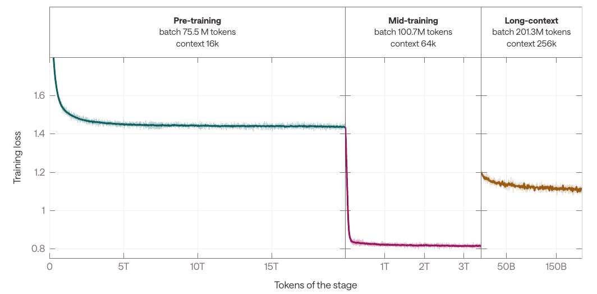

## Figure 18 · Base model up to 1M context

Compare variable tracking with word extraction and QA. They probe different capabilities. [Source page 43](https://aleph-alpha.com/downloads/tech-report.pdf#page=43)

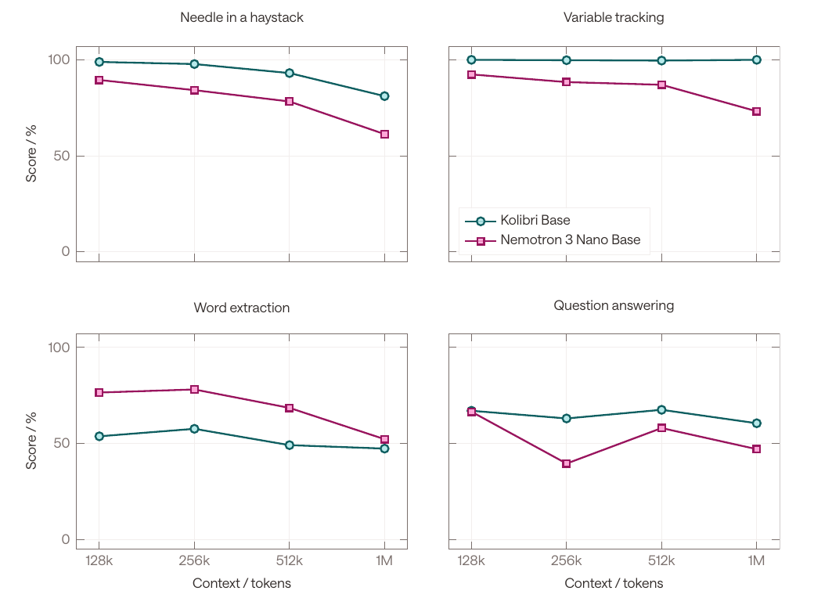

## Figure 23 · Long-document conversations

Follow the sampled passages back into the assembled document and conversation. [Source page 57](https://aleph-alpha.com/downloads/tech-report.pdf#page=57)

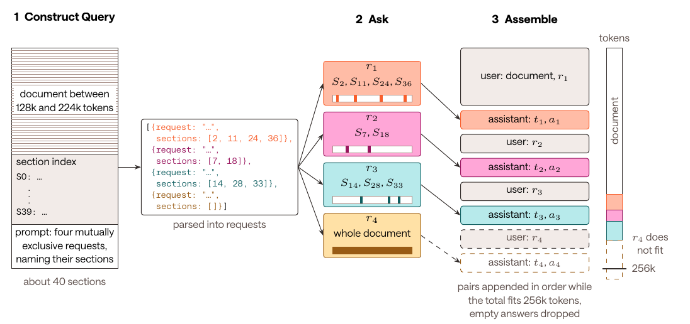

## Figure 26 · Effort labels

Find the difficulty grading, length percentiles and resulting effort label. [Source page 61](https://aleph-alpha.com/downloads/tech-report.pdf#page=61)

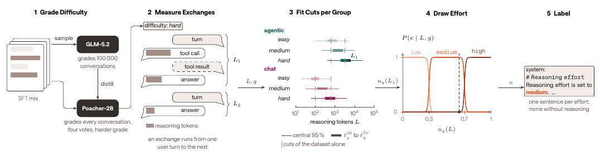

## Figure 36 · RL cluster layout

Follow requests from rollout workers to inference and outcomes back toward the trainer. [Source page 82](https://aleph-alpha.com/downloads/tech-report.pdf#page=82)

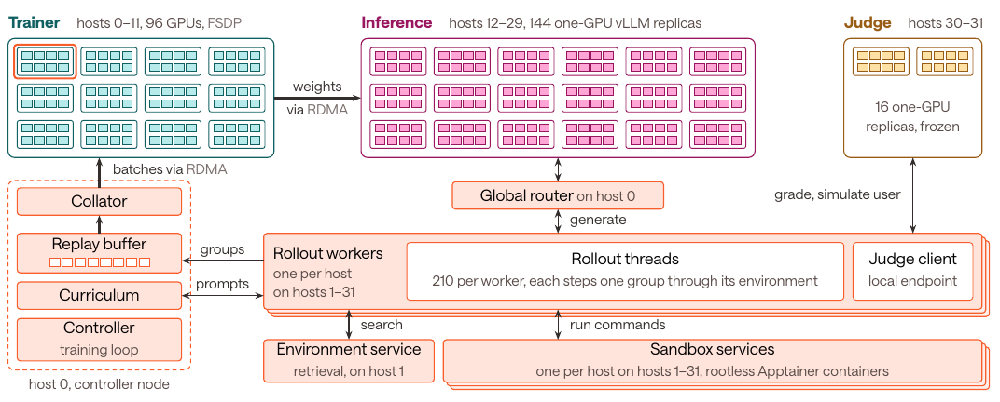

## Figure 39 · Reward by environment

Look at groups separately. The overall trend can hide differences in when learning takes off. [Source page 87](https://aleph-alpha.com/downloads/tech-report.pdf#page=87)

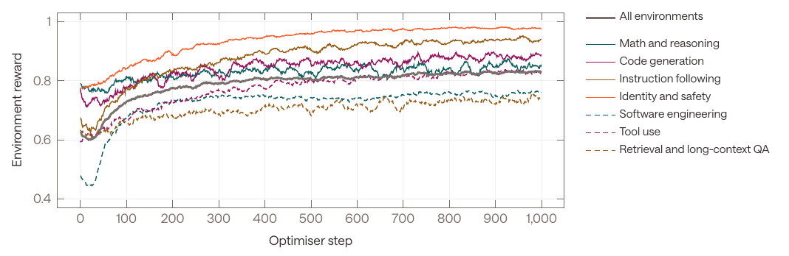

## Figure 1 · Quality and throughput

Read one panel at a time. Check both axes and find the predecessor point. [Source page 1](https://aleph-alpha.com/downloads/tech-report.pdf#page=1)

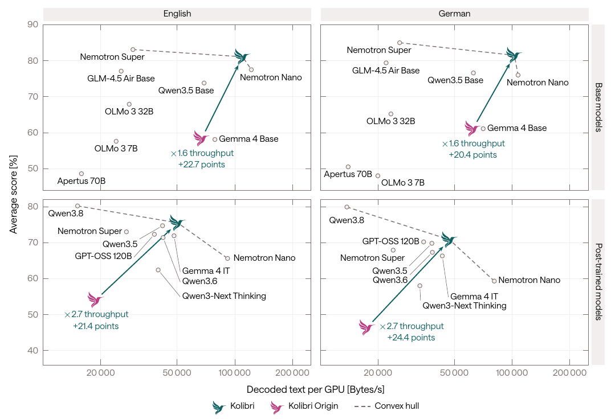

## Figure 64 · HumanEval recitation

Compare the overall score, recitation share and unrecited score at the same checkpoint. [Source page 160](https://aleph-alpha.com/downloads/tech-report.pdf#page=160)

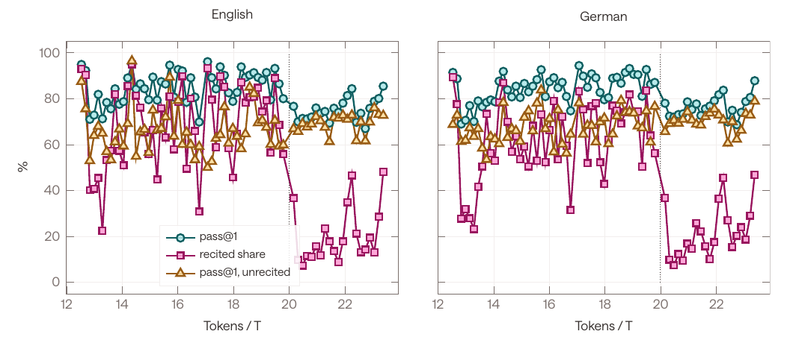

## Figure 65 · Reasoning at long context

Compare reasoning on and off across task types as context increases. [Source page 167](https://aleph-alpha.com/downloads/tech-report.pdf#page=167)

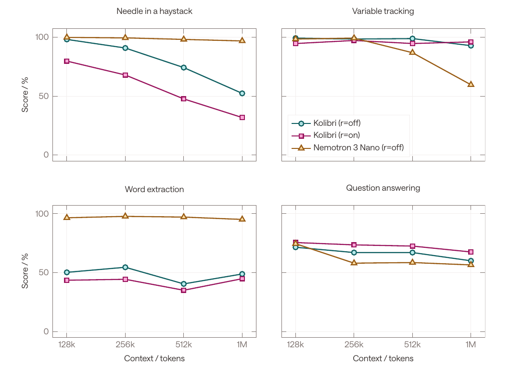
